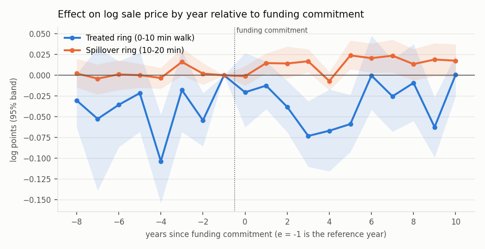

# West Seattle value capture: not material

Decision memo · 15 November 2026 · For: Sound Transit finance team · Prototype on open data; read the limits before relying on it.

## Decision

Do not build the West Seattle funding plan around value capture on this evidence. The pre-registered protocol stops at gate G2: exit: negative effect; reject value capture on this evidence. Every specification that yields an elasticity puts it below the 0.060 a local improvement district needs to raise 5% of the funding gap; the highest point estimate or upper bound is 0.057. The estimate behind the stop also fails 4 of the falsification tests, so read it as "no credible positive effect found", not as proof that Link lowered prices.

## Why

- **No detectable price gain after funding was committed** [G2]. Homes within a 10-minute walk of a new station sold for -3.3% relative to homes 20–40 minutes away (95% interval -6.0% to -0.4%; 8,644 treated of 125,812 sales; 37 station clusters). The 10–20 minute ring moved +1.4% (+0.3% to +2.6%).
- **The estimate is fragile** [G3]. Failed: planted effect, pretrend bounds, placebo stations, composition. Passed: placebo date, leave one station out. Blocked: rezoning split (no zoning history). The planted-effect interval covered the truth in 80.0% of runs (90% needed), so the intervals here are too narrow. Pre-period coefficients move by up to 8.6 points a year, so one base year can shift the whole estimate.
- **The answer depends on which date counts as treatment** [G2]. Dated from announcement: +0.9%. Dated from opening: +5.2% (+1.8% to +8.6%). Central Link's surface construction ran between funding and opening, which fits a dip followed by recovery.
- **Even the most favourable reading falls short** [G1, G4]. Elasticity: 0.012 (95% interval 0.002 to 0.022, from 3 stations); opening-dated 0.057; needed 0.060.
- **Revenue would be small** [G4]. Median present value of net LID revenue is $21 million, 0.9% of the gap (80% range 0.0% to 2.7%). Probability of reaching 5%: 1.7%. LID payments start after the gain is realized, so in years 1–10 they cover 0.0% of debt service at the 10th percentile.
- **The tax increment area is capped by law** [G0, G4]. RCW 39.114's $200 million limit per area admits 352 of the 2,591 parcels within a 10-minute walk of the two stations. Its gross take would be $33 million in present value; $1 million of that is caused by the line. The rest is ordinary growth diverted from schools, the county and other taxing districts.

## What would change this conclusion

- **A stronger design showing an elasticity above 0.060** [G1, G2]: archived timetables with buses (the current dose omits them), condominium sales, and an averaged base period.
- **A much smaller funding gap** [G4]. At the median LID revenue, the gap would have to be below $412 million for the ratio to reach 5%. Across the reported range ($0.8–3.8 billion) the ratio runs only from 0.6% to 2.0%, so a firm agency figure inside that range would not change the answer.
- **A legal change** [G0]: Sound Transit gaining LID powers, or a higher TIA cap.

## Gates

| Gate | Question | Result |
|---|---|---|
| G0 | Is a value-capture instrument legally available to a sponsor? | pass |
| G1 | Can the corridor detect the break-even effect? | pass |
| G2 | Is there a capitalization effect, and is the answer precise? | exit: negative effect; reject value capture on this evidence |
| G3 | Does the estimate survive the falsification suite? | exit: failed planted effect, pretrend bounds, placebo stations, composition (after the stop; for information) |
| G4 | Is net revenue likely to be material to the funding plan? | exit: not material (after the stop; for information) |
| G5 | Does the instrument transfer to the planned line with acceptable incidence? | pass (after the stop; for information) |

## Limits

- Buses are not modelled, so the access gain is overstated (ADR-0002).
- Four of nine funding cohorts have enough sales a year to enter; the elasticity rests on 3 stations (ADR-0006).
- Plan v2 added submarket terms after the planted-effect test exposed a bias; the v1 results are kept for comparison (ADR-0007).
- The funding gap is a reported range of $0.8–3.8 billion, not an agency figure (ADR-0005).
- Land share of single-family value near the planned stations: 54.4% by the assessor's split, 6.7% from vacant-lot sales. The second is implausibly low (vacant lots that sell are often steep or unbuildable), so the land-effect percentages use the assessor's split. The dollar base does not depend on it: the whole gain is land.
- Legal points need counsel ([legal memo](legal_memo.md)).

**Ask:** send the agency's West Seattle funding-gap figure, and decide whether to fund the phase-2 design (archived timetables with buses, condominium sales) before value capture is reconsidered.

Go deeper: [pre-analysis plan](pre_analysis_plan.md) · `outputs/results/` · `outputs/atlas/index.html` · `docs/decisions/`.
